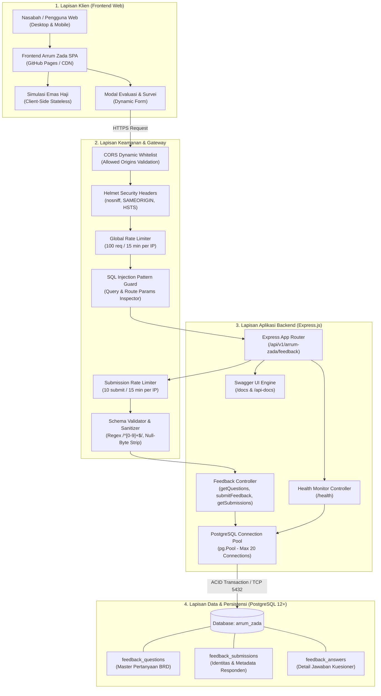
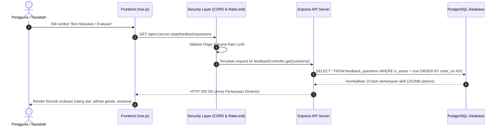
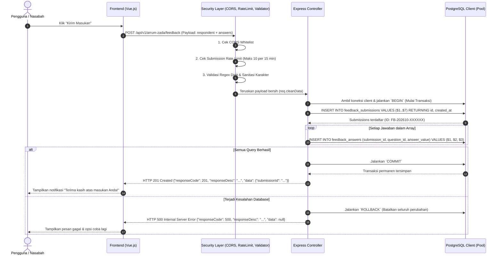
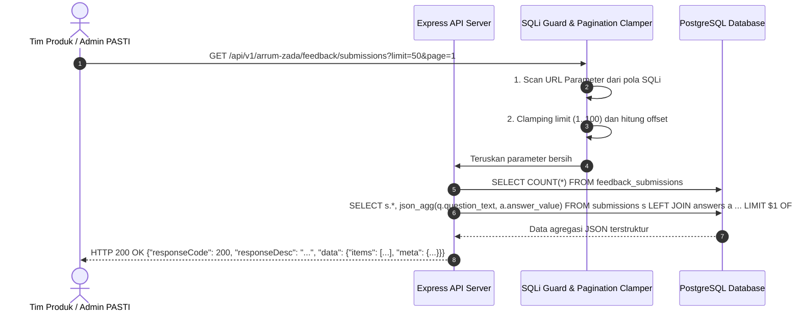
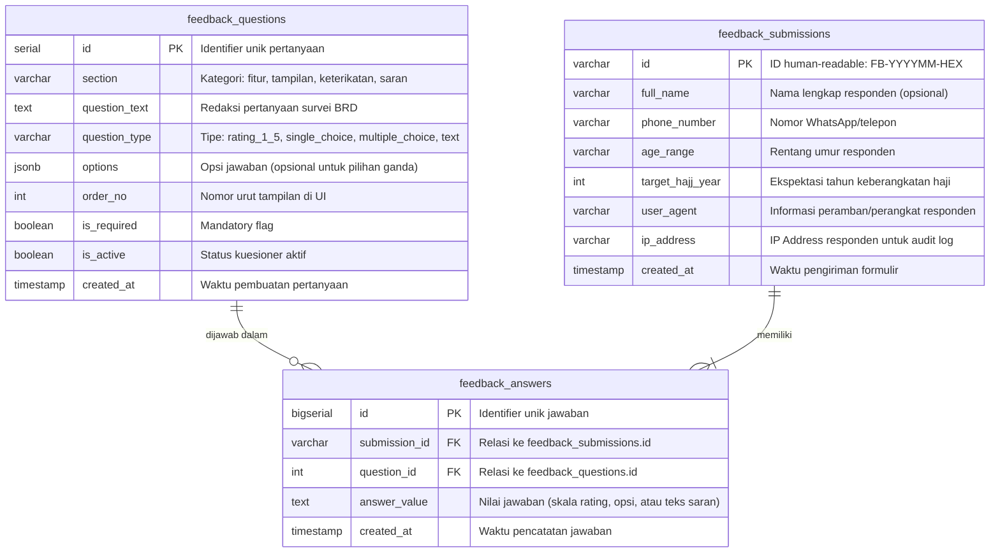
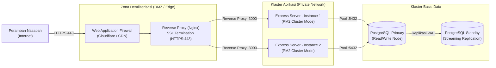

# HIGH LEVEL DESIGN (HLD)
## Arrum Zada Feedback & Evaluation Platform
**PT Pegadaian — Divisi Pengembangan Aplikasi TI (PASTI)**  
*Dokumen Arsitektur Sistem, Integrasi API, dan Keamanan Berlapis*

---

> [!NOTE]
> Dokumen **High Level Design (HLD)** ini merangkum rancangan arsitektur, integrasi modul, aliran data, strategi keamanan, dan topologi deployment untuk platform pengumpulan evaluasi dan feedback dashboard simulasi emas haji **Arrum Zada** berdasarkan dokumen spesifikasi kebutuhan produk (BRD Iterasi 2).

---

## 1. Latar Belakang & Filosofi Desain

### 1.1 Konteks Bisnis
Aplikasi web [Arrum Zada](https://ifatich.github.io/arrum-zada/) menyajikan simulasi interaktif rencana porsi haji berbasis tabungan emas bagi nasabah PT Pegadaian. Untuk mengukur kesiapan pasar (*product-market fit*), kejelasan tata letak (*user experience*), dan minat nasabah terhadap akad syariah, dibangun modul kuesioner evaluasi yang terintegrasi langsung ke backend terpusat.

### 1.2 Prinsip Arsitektur Utama
- **Stateless Client-Side Simulation:** Seluruh kalkulasi konversi dana, fluktuasi estimasi gram emas, dan simulasi cicilan bulanan dieksekusi secara instan di sisi browser (client-side) tanpa membebani server backend atau menyimpan data simulasi sementara di database.
- **ACID Transactional Feedback:** Seluruh data evaluasi responden dan rincian jawaban survei disimpan ke PostgreSQL menggunakan transaksi database atomik (`BEGIN ... COMMIT / ROLLBACK`) untuk menjamin konsistensi data.
- **Dynamic Survey Management:** Butir-butir pertanyaan survei tidak di-*hardcode* di frontend, melainkan dikonfigurasi melalui basis data sehingga dapat disesuaikan sewaktu-waktu tanpa perlu melakukan *re-deploy* aplikasi frontend.
- **Defense-in-Depth Security:** Mengadopsi prinsip keamanan berlapis mencakup kontrol asal domain (CORS Whitelist), pencegahan brute-force (Rate Limiting), sanitasi input, parameter binding ($1, $2, ...), serta HTTP security headers.

---

## 2. Arsitektur Sistem Tingkat Tinggi

Diagram berikut mengilustrasikan topologi arsitektur sistem secara *end-to-end*, mulai dari interaksi nasabah di peramban hingga lapisan persistensi basis data:

---

## 3. Komponen Utama Sistem

### 3.1 Presentation Tier (Frontend Web)
- **Teknologi:** Vue.js, Tailwind CSS / Vanilla JS terbundel.
- **Hosting:** GitHub Pages (`https://ifatich.github.io/arrum-zada/`).
- **Fungsi:** 
  1. Melakukan kalkulasi simulasi porsi haji secara matematis di browser nasabah.
  2. Mengonsumsi endpoint `GET /questions` untuk memuat pertanyaan kuesioner dinamis saat modal masukan dibuka.
  3. Mengirimkan masukan ke endpoint `POST /feedback` saat tombol *Submit* ditekan.

### 3.2 Security & Protection Tier
- **CORS Whitelist (`corsHandler.js`):** Memvalidasi header `Origin` hanya untuk domain resmi yang terdaftar (GitHub Pages, localhost Vite, dan Live Server). Request dari domain asing ditolak dengan respon HTTP `403 Forbidden`.
- **Anti-Bruteforce & Anti-Spam (`rateLimiter.js`):** Membatasi laju permintaan global (100 req/15 menit) dan pengiriman formulir masukan (10 formulir/15 menit). Melebihi batas menghasilkan HTTP `429 Too Many Requests`.
- **SQLi Inspector & Sanitizer (`sqlInjectionGuard.js` & `validateInput.js`):** Memindai URL parameters dari serangan injection (`UNION`, `DROP TABLE`, `OR 1=1`), mensterilkan karakter null-byte (`\0`), serta memvalidasi tipe data integer dengan regex `/^\d+$/`.
- **HTTP Hardening (Helmet):** Mengaktifkan proteksi MIME-type sniffing (`nosniff`), Clickjacking (`X-Frame-Options: SAMEORIGIN`), dan HSTS tanpa merusak tata letak Swagger UI.

### 3.3 Application Tier (REST API Service)
- **Teknologi:** Node.js v18+ dengan Express.js 5.
- **Lokasi Proyek:** `arrum-zada-api`
- **Komponen:**
  - `src/controllers/feedbackController.js`: Logika bisnis dan orkestrasi transaksi basis data.
  - `src/config/db.js`: Pengelolaan connection pool PostgreSQL (`max: 20`, `idleTimeoutMillis: 30000`).
  - `src/docs/swaggerDoc.js`: Definisi skema interaktif OpenAPI 3.0.

### 3.4 Data Tier (PostgreSQL Relational Storage)
- **RDBMS Engine:** PostgreSQL 12 (Container `pg-local` port 5432).
- **Integritas Referensial:** Menggunakan `FOREIGN KEY ... ON DELETE CASCADE` antara tabel submissions dan answers untuk menjaga keutuhan relasi data.
- **Indeks Basis Data:** Dibuat indeks terklasifikasi pada `created_at DESC`, `submission_id`, `question_id`, dan `order_no` guna menjamin efisiensi performa pembacaan laporan berskala besar.

---

## 4. Aliran Transaksi & Integrasi Data

### 4.1 Alur 1: Memuat Kuesioner Dinamis (`GET /questions`)
Alur kerja ketika pengguna membuka pop-up atau modal evaluasi di aplikasi frontend:

---

### 4.2 Alur 2: Pengiriman Masukan Responden (`POST /feedback` - ACID Transaction)
Alur ketika nasabah menekan tombol "Kirim Masukan" pada formulir evaluasi:

---

### 4.3 Alur 3: Rekapitulasi Masukan Admin (`GET /submissions`)
Alur untuk tim produk dan Divisi PASTI saat menarik data agregasi hasil evaluasi:

---

## 5. Perancangan Basis Data (Entity-Relationship Model)

Basis data `arrum_zada` dirancang secara normalisasi relasional dengan dukungan format semi-terstruktur `JSONB` untuk opsi pilihan ganda:

### 5.1 Strategi Indeks & Performa Query
- `idx_feedback_submissions_created_at`: Mengoptimalkan pengurutan data terbaru secara descending pada dashboard reporting.
- `idx_feedback_answers_submission_id`: Menghindari table scan saat melakukan `LEFT JOIN` antara tabel submissions dan answers.
- `idx_feedback_answers_question_id`: Mempercepat agregasi statistik rata-rata rating kepuasan per pertanyaan.
- `idx_feedback_questions_order`: Menjamin pembacaan pertanyaan berurutan tanpa penundaan latensi.

---

## 6. Arsitektur Keamanan Berlapis (Defense-in-Depth)

Sistem mengimplementasikan prinsip keamanan 4 lapis:

| Lapis Keamanan | Komponen Teknis | Mekanisme Perlindungan |
| :--- | :--- | :--- |
| **Layer 1: Perimeter & Origin** | `corsHandler.js` | Membatasi domain pemanggil hanya ke whitelist (`https://ifatich.github.io`, localhost dev). Menolak domain asing dengan **HTTP 403 Forbidden**. Preflight cache di browser selama 24 jam. |
| **Layer 2: Anti-Bruteforce & DoS** | `rateLimiter.js` | Menerapkan token bucket berbasis alamat IP:  • **Global:** 100 req/15 menit. • **Submit:** 10 submit/15 menit untuk mencegah spam data sampah. Respon: **HTTP 429 Too Many Requests**. |
| **Layer 3: Anti-SQL Injection** | `sqlInjectionGuard.js` & `validateInput.js` | • Memindai pola `UNION`, `DROP TABLE`, `OR 1=1` pada query string (Respon: **HTTP 400**). • Regex digit murni `/^\d+$/` untuk seluruh ID numerik. • Sanitasi karakter null-byte (`\0`) dan batasan ukuran teks. |
| **Layer 4: Persistensi Aman** | `pg.Pool` & Transaction | Menggunakan **Parameterized Queries ($1, $2, ...)** resmi PostgreSQL. Nilai masukan dipisahkan pada level protokol biner, sehingga teks penyerang seperti `' OR '1'='1'` diperlakukan 100% sebagai literal data string. |

---

## 7. Spesifikasi Kontrak API & Endpoints

Seluruh endpoint terintegrasi dengan antarmuka interaktif OpenAPI 3.0 di [http://localhost:3000/docs](http://localhost:3000/docs):

| Method | Path Endpoint | Akses | Fungsi & Respon Utama |
| :--- | :--- | :--- | :--- |
| `GET` | `/health` | Publik | Monitor ketersediaan server dan koneksi aktif PostgreSQL (`200 UP` / `503 DEGRADED`). |
| `GET` | `/docs` / `/api-docs` | Publik | Dokumentasi interaktif Swagger UI lengkap dengan skema request & response. |
| `GET` | `/api/v1/arrum-zada/feedback/questions` | Frontend | Mengambil seluruh butir pertanyaan kuesioner aktif (`200 OK`). |
| `POST` | `/api/v1/arrum-zada/feedback` | Frontend | Mengirim masukan kuesioner secara transaksional (`201 Created`, `400 Bad Request`, `429 Too Many Requests`). |
| `GET` | `/api/v1/arrum-zada/feedback/submissions` | Internal | Mengambil riwayat masukan masuk dengan paginasi aman (`200 OK`). |

---

## 8. Topologi Infrastruktur & Deployment

### 8.1 Lingkungan Pengembangan Lokal (Current Setup)
- **Host Mesin:** Local Development Workstation (Windows).
- **Runtime:** Node.js v18+ mengeksekusi Express server pada port `3000`.
- **Database Server:** Docker container `pg-local` mengeksekusi image `postgres:12` pada port `5432`.
- **Frontend Client:** GitHub Pages `https://ifatich.github.io/arrum-zada/`.

### 8.2 Topologi Target Produksi (Production Blueprint)

---

## 9. Kebutuhan Non-Fungsional (NFR)

1. **Ketersediaan (Availability):**
   - Target ketersediaan layanan backend $\ge 99.5\%$ pada jam operasional layanan simulasi emas haji.
   - Pemeriksaan kesehatan otomatis melalui endpoint `/health`.
2. **Kinerja & Latensi (Performance):**
   - Waktu respons API `GET /questions` di bawah **150 ms**.
   - Waktu respons transaksi `POST /feedback` di bawah **300 ms** pada beban transaksi standar.
3. **Integritas & Auditabilitas Data:**
   - Tidak ada data jawaban tanpa entitas submissions (*Zero Orphan Rows*) berkat proteksi Foreign Key.
   - Audit trail mencatat `created_at`, `ip_address`, dan `user_agent` untuk setiap pengiriman formulir.
4. **Penskalaan (Scalability):**
   - Arsitektur stateless pada Express.js memudahkan penambahan instance secara horizontal (*horizontal pod autoscaling*) di balik reverse proxy.

---

> [!TIP]
> Dokumen HLD ini dapat dijadikan acuan resmi bagi tim Frontend, Backend, Database Administrator, dan Security Auditor Divisi PASTI PT Pegadaian dalam memelihara serta mengembangkan integrasi ekosistem Arrum Zada.
